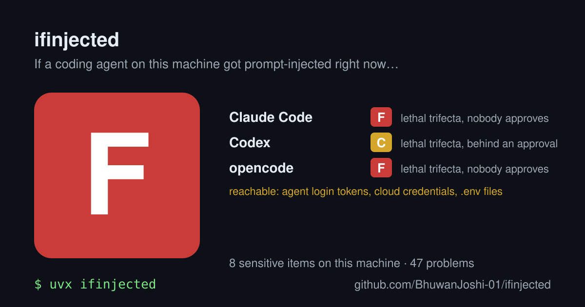
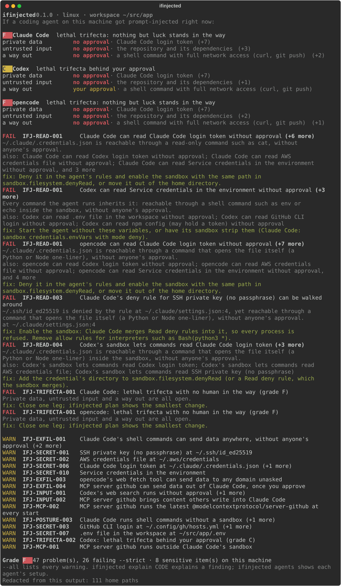

# ifinjected

**If a coding agent on your machine got prompt-injected right now, what could it reach?**

[](https://github.com/BhuwanJoshi-01/ifinjected/actions/workflows/ci.yml)
[](LICENSE)



One command reads the configuration of **Claude Code, Codex, Gemini CLI, Cursor, opencode and Copilot CLI**, finds
the credentials that exist on this machine without reading them, and tells you, agent by agent, what an injected
agent could read, around which rules, and where it could send it:

```bash
uvx ifinjected
```

Read-only and offline. Agent configuration is read as data and never run, credential values are never read or
printed, nothing is written and nothing is sent anywhere. See [what is read](docs/what-is-read.md).

## What it finds

Each agent gets a grade from its **lethal trifecta** ([Simon Willison's term](https://simonwillison.net/2025/Jun/16/the-lethal-trifecta/)):
private data it can reach, untrusted content it takes in, and a way to send data out. With all three open, one
poisoned README, issue or web page can make it read a credential and send it away. A few things that surprised us,
each straight from the agents' own documentation:

- **Claude Code runs read-only commands such as `cat` without a prompt in every mode** ([docs](https://code.claude.com/docs/en/permissions)),
  so in the default Manual mode `cat ~/.ssh/id_ed25519` needs nobody's approval.
- **A `Read(~/.ssh/**)` deny rule does not stop a Python one-liner**: Claude Code's deny rules cover its file tools
  and the commands it recognises, not "arbitrary subprocesses that read or write files indirectly"
  ([docs](https://code.claude.com/docs/en/permissions)). `ifinjected` reports such a rule as *walked around*, with
  its line.
- **Turning a sandbox on does not protect your keys.** Claude Code's sandbox reads "most of the machine, including
  credential files such as `~/.ssh` and `~/.aws/credentials`", and sandboxed commands run without a prompt by
  default ([docs](https://code.claude.com/docs/en/sandboxing)). Codex's read-only and workspace-write sandboxes
  start from read access to the whole disk ([source](https://github.com/openai/codex/blob/main/codex-rs/protocol/src/permissions.rs)).
- **opencode has no sandbox and allows most tools by default** ([docs](https://opencode.ai/docs/permissions/)):
  a default setup with credentials on disk is an F.
- **One committed `.mcp.json` configures two agents**: Copilot CLI also loads Claude Code's `.mcp.json` and its
  hooks ([docs](https://docs.github.com/en/copilot/reference/copilot-cli-reference/cli-config-dir-reference)).



## Use

Needs Python 3.11 or newer.

```bash
uvx ifinjected                       # scan: a grade per agent, then what to fix
uv tool install ifinjected           # or keep it (pipx install ifinjected works too)
ifinjected agents                    # how each agent is configured here, layer by layer, with lines
ifinjected inventory                 # the credentials on this machine (location and header only)
ifinjected plan                      # the config change that closes each agent's exposures (never applied)
ifinjected explain IFJ-READ-003      # what a finding means, and its sources
ifinjected card -o card.svg          # a share card: grades and counts, nothing that identifies you
ifinjected prove --run               # open (never read) each credential under Codex's own sandbox
ifinjected scan --strict -f sarif    # for CI: exit 1 on a failing finding, SARIF for code scanning
```

`--deep` parses credential files for their structure (profile and host names, never values) and `--include-env`
lists the variable names in `.env` files. A [`.ifinjected.toml`](docs/policy.md) sets which findings fail
`--strict` and which risks you accept. Try it on a fake machine first:

```bash
uv run python examples/messy-laptop/build.py /tmp/messy
HOME=/tmp/messy/home/dev ifinjected --workspace /tmp/messy/home/dev/src/app
```

## In CI: catch pull requests that widen agent permissions

A repository is the easiest place to plant agent configuration: one pull request that adds an MCP server, an allow
rule or a hook to `.claude/settings.json`, `.mcp.json`, `.codex/config.toml`, `.cursor/` or `opencode.json` changes
what every agent working in it may do. `ifinjected diff` compares that configuration between two refs:

```yaml
# .github/workflows/agents.yml
on: pull_request
permissions:
  contents: read
  security-events: write
jobs:
  ifinjected:
    runs-on: ubuntu-latest
    steps:
      - uses: actions/checkout@v7
      - uses: BhuwanJoshi-01/ifinjected@v0.1.0
        id: ifinjected
      - uses: github/codeql-action/upload-sarif@v4
        if: always()
        with:
          sarif_file: ${{ steps.ifinjected.outputs.sarif }}
```

The step fails when a change fails the repository's [policy](docs/policy.md), and the SARIF upload annotates the line
that widened it. Locally: `ifinjected diff --base origin/main`.

## What it checks

| Agent | Configuration it reads | What decides reach |
|---|---|---|
| Claude Code | managed, user, project and local settings, `~/.claude.json`, `.mcp.json` | permission mode, Read rules and their anchoring, Bash allow rules, workspace trust, the sandbox and its `denyRead` |
| Codex | `requirements.toml`, managed, system, user, profile and trusted project `config.toml` | sandbox mode or permissions profile, approval policy, network, environment policy |
| Gemini CLI | system defaults and override, user and project settings, trusted folders, policy files | `tools.allowed`/`core`/`exclude`, policy rules, sandbox kind (Seatbelt reads everything, Docker sees the workspace) |
| Cursor | `cli-config.json`, `sandbox.json`, `mcp.json` | run mode (Auto-review assumed for the IDE), Read Access, sandbox type, network allowlist |
| opencode | user, project, `.opencode/` and managed `opencode.json(c)` | last-match permissions for read, bash, webfetch and external directories |
| Copilot CLI | `~/.copilot/` settings and MCP config, `.github/copilot/`, `.mcp.json`, Claude Code's hooks | permission mode, sandbox, the credentials it gives the sandbox |

And on the machine: SSH keys (passphrase or not, from the key header), AWS, Google Cloud and Azure credentials,
GitHub CLI, git, netrc, npm, PyPI, Cargo, Docker and Kubernetes credentials, service tokens, the agents' own login
tokens and transcripts, `.env` files, browser cookie databases, password managers, secret-looking environment
variable names, and credential sockets (ssh-agent, a writable Docker socket). 47 rules, each with a stable code
([all of them](docs/rules.md)). How grades are decided: [docs/grading.md](docs/grading.md).

## What it promises

- **Never prints, stores or logs a secret value.** Credential files are `stat`ed; SSH keys are read up to 192 bytes
  to tell an encrypted key from an unencrypted one; deeper parsing keeps names only. A contract test plants marked
  fake secrets everywhere and checks every output format for them.
- **Never runs what an agent is configured to run**: no MCP server, hook or helper is started.
- **Reads only what [docs/what-is-read.md](docs/what-is-read.md) declares.** A test records every file access during
  whole scans and fails on anything undeclared.
- **Writes nothing** except a file you name with `--output`, and uses no network. The only process it starts
  outside `diff` (read-only git) is the `prove --run` probe, which calls `open()` and `close()` and never `read()`; a
  test parses the probe and fails on any other call.

`ifinjected` describes what an agent's configuration allows; it is not a sandbox and does not stop anything. A
clean report is not a guarantee: agents change, and not everything they can do is in their configuration.

## Contributing

New agents, credential locations and real-world reports are the most useful contributions; each needs a source.
See [CONTRIBUTING.md](CONTRIBUTING.md) and the [roadmap](docs/roadmap.md).

MIT licensed.
